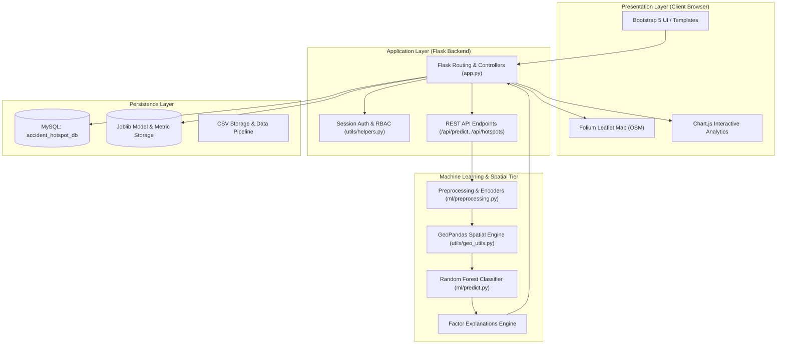
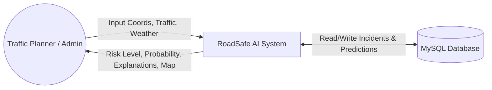
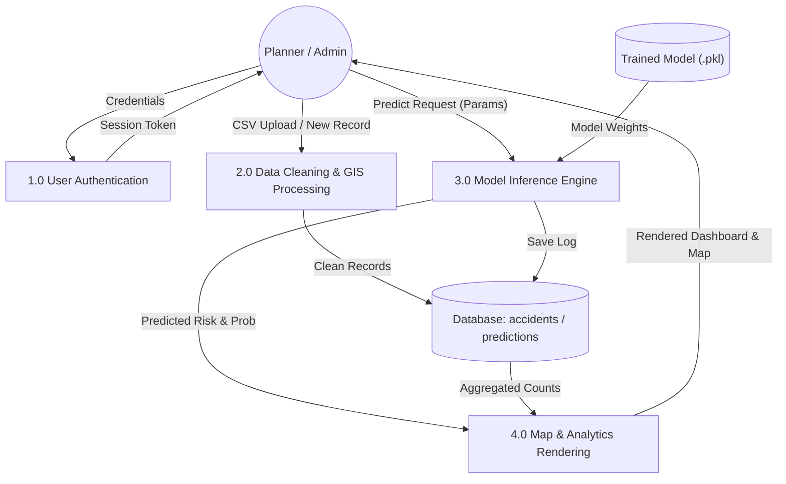
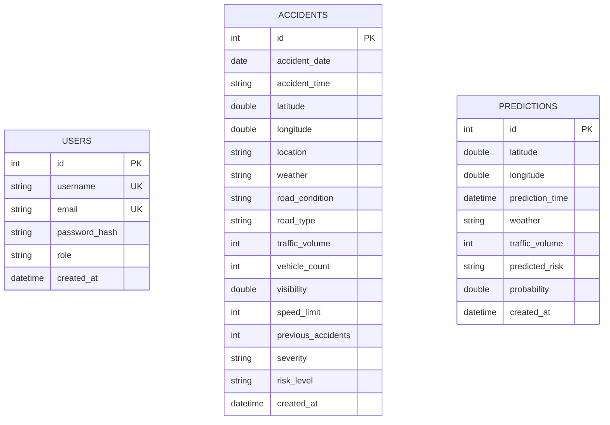
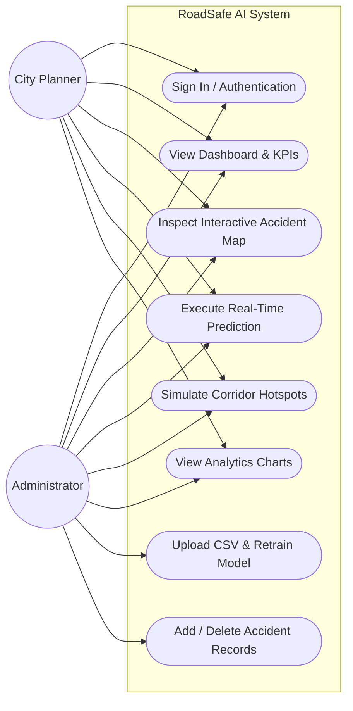
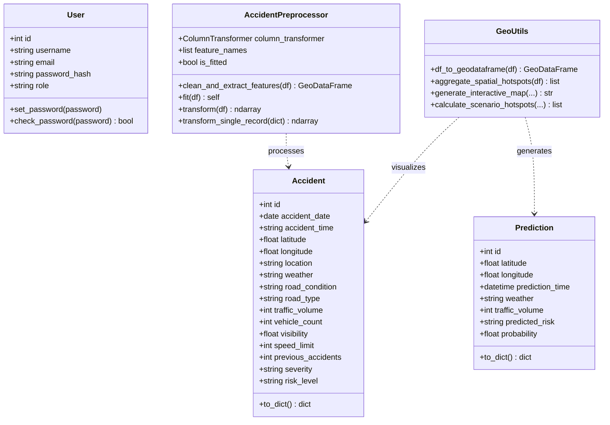

# Real-Time Road Accident Hotspot Prediction and Visualization System
## Master of Computer Applications (MCA) Final Year Project Report

---

### Abstract
Rapid urbanization and expanding vehicular density have elevated traffic collision fatalities into a critical global public health and economic crisis. Traditional road safety management systems rely primarily on retrospective accident reports, lacking predictive intelligence and spatial dynamic modeling. This project presents **RoadSafe AI**, a comprehensive, full-stack spatial decision support platform engineered using Python, Flask, MySQL, GeoPandas, Folium, and Scikit-learn. Utilizing a balanced Random Forest ensemble architecture trained on 6,000 spatial and environmental records, the system models non-linear interactions across traffic volumes, diurnality, precipitation, road friction, and geographic blackspot history. The platform delivers an interactive Folium cartographic interface featuring density heatmaps, single-coordinate real-time risk predictions with factor explanations, dynamic multi-zone scenario simulation, and eight exploratory analytics dashboards. Achieving an 81.08% classification accuracy and robust precision-recall balance, RoadSafe AI demonstrates practical applicability for municipal authorities, highway engineers, and traffic enforcement agencies.

---

### Introduction
Road traffic collisions represent one of the leading causes of preventable deaths and serious injuries worldwide. Modern urban agglomerations face unprecedented challenges in managing complex arterial corridors, ring roads, and expressway interchanges. Mitigating vehicular risk necessitates moving beyond reactive post-incident policing toward predictive spatial computing. By synthesizing GIS coordinates, environmental indicators, and machine learning classifiers, modern systems can quantify hazard probability before accidents occur. This project develops a unified end-to-end framework integrating data engineering, spatial computing, machine learning, and interactive web visualization.

---

### Problem Statement
Municipal traffic management divisions and urban road transport authorities encounter multiple operational bottlenecks:
1. **Retrospective Analysis Bias**: Traditional safety audits analyze accidents weeks or months after occurrence, failing to prevent imminent collisions under changing weather or traffic loads.
2. **Spatial Data Fragmentation**: Accident reports frequently lack unified geospatial Coordinate Reference System (CRS) normalization, rendering hotspot identification inaccurate.
3. **Black-Box Decision Making**: Conventional statistical tools do not isolate key contributing hazard factors (e.g., severe congestion vs. adverse wet surface skidding), limiting actionable police interventions.
4. **Lack of Dynamic Simulation**: Authorities cannot simulate "what-if" operational conditions (such as a monsoon thunderstorm during Friday evening rush hour) across major transit corridors.

---

### Existing System
Existing accident tracking systems typically consist of:
* Manual police first information reports (FIR) entered into static relational ledgers.
* Basic spreadsheet aggregations summarizing raw incident counts per district.
* Static map pins without risk probability weighting, density heatmaps, or machine learning classification.

#### Limitations of Existing System:
* Zero predictive capability for future time slots or varying weather conditions.
* Vulnerable to human data entry error and duplicate records.
* Inability to evaluate multidimensional interactions between speed limits, weather, visibility, and traffic volume simultaneously.
* High latency in dispatching preventive patrols to high-risk corridors.

---

### Proposed System
The proposed **RoadSafe AI** system establishes an end-to-end predictive ecosystem:
1. **Automated Data Processing Pipeline**: Cleans, validates spatial boundaries, extracts temporal cyclical components, and builds GeoPandas GeoDataFrames.
2. **Ensemble Machine Learning Core**: Random Forest Classifier featuring 120 estimators, depth regularization, and class weighting to classify risk into Low, Medium, and High categories.
3. **Explainable AI Layer**: Calculates factor impact breakdowns for every individual prediction to assist field officers in identifying root causes.
4. **Interactive GIS Cartography**: Folium OpenStreetMap layers with interactive heatmaps, custom popup risk cards, and zoom/pan functionality.
5. **Dynamic Scenario Simulator**: Allows planners to test customized combinations of date, time, weather, and traffic density across all metropolitan corridors.
6. **Role-Based Access Control**: Secure Flask session management distinguishing Administrative tasks (CSV ingestion, model retraining, record deletion) from Planner tasks (inference, map viewing, analytics).

---

### Objectives
* Develop a robust data generation and preprocessing pipeline supporting real-world GIS coordinates (EPSG:4326).
* Train a supervised Random Forest classification model achieving >80% accuracy in predicting accident risk severity.
* Construct an explainability module highlighting key environmental and infrastructural hazard contributors.
* Embed an interactive Folium cartographic interface inside a responsive Bootstrap 5 web dashboard.
* Build high-performance RESTful API endpoints for accident data querying, live risk inference, and analytics aggregation.
* Implement a secure MySQL database schema equipped with spatial and indexing optimizations.

---

### Scope
The system is scoped for metropolitan traffic monitoring jurisdictions, state highway development authorities, and smart city operations centers. It operates across urban expressways, major signalized intersections, commercial corridors, and suburban tech hubs. It accommodates varied meteorological phenomena (monsoon rain, dense fog, thunderstorms) and diurnality patterns across 24-hour cycles.

---

### Methodology
The project follows an iterative Data Science and Agile Software Development Methodology:
1. **Data Ingestion & Verification**: Load 6,000 spatial records, remove duplicates, filter invalid coordinates, and handle missing values.
2. **Feature Engineering**: Extract cyclical hours, days, months; perform one-hot encoding on categorical attributes (`weather`, `road_condition`, `road_type`).
3. **Model Formulation**: Implement Random Forest Classifier with stratified 80:20 training-testing partitioning.
4. **Model Serialization**: Persist trained weights and pipeline transformers using `joblib`.
5. **Full-Stack Integration**: Expose model via Flask web routes and REST endpoints; render maps with Folium and dynamic charts with Chart.js.
6. **Automated Verification**: Rigorous testing across unit, integration, and API layers using `pytest`.

---

### System Architecture
The system employs a 4-tier modular architecture: Presentation Tier, Application Tier, Analytics/ML Tier, and Data Persistence Tier.

---

### Data Flow Diagram

#### Level 0 DFD (Context Diagram)

#### Level 1 DFD

---

### ER Diagram
The relational database design structures accident records, logged predictions, and authenticated users with appropriate indexing.

---

### Use Case Diagram

---

### Class Diagram

---

### Database Design
The application connects to `accident_hotspot_db` with performance-optimized schema definitions:
* **accidents Table**:
  - `id`: Integer primary key, auto-incrementing.
  - `accident_date`, `accident_time`: Date and time of incident.
  - `latitude`, `longitude`: Spatial floating-point coordinates indexed via `idx_lat` and `idx_lon`.
  - `location`: Corridor or intersection descriptor.
  - `traffic_volume`, `speed_limit`, `visibility`, `previous_accidents`: Continuous and discrete metrics.
  - `weather`, `road_condition`, `road_type`, `severity`: Categorical status attributes.
  - `risk_level`: Target class (`Low`, `Medium`, `High`), indexed via `idx_risk`.
* **predictions Table**:
  - Stores historical inference queries with coordinates, weather, traffic, risk level, and probability.
* **users Table**:
  - Secure credential storage featuring `pbkdf2:sha256` password hashing.

---

### Machine Learning Methodology & Random Forest Algorithm
The prediction engine utilizes a Random Forest Classifier consisting of an ensemble of $B$ decorrelated decision trees $\{T_1, T_2, \dots, T_B\}$:
1. **Bootstrap Aggregating (Bagging)**: For each tree $b = 1, \dots, B$, a bootstrap sample $Z^*$ of size $N$ is drawn with replacement from the training dataset.
2. **Random Subspace Method**: At each candidate split node in tree $b$, a random subset of $m \approx \sqrt{p}$ features is selected from the total $p$ features to determine the split that minimizes Gini Impurity:
   $$I_G(p) = 1 - \sum_{k=1}^{K} p_k^2$$
3. **Class Balancing**: Sample weights are inversely proportional to class frequencies to prevent bias:
   $$w_j = \frac{N}{K \cdot n_j}$$
4. **Ensemble Voting**: Probability for class $k$ is computed by averaging the class posterior probabilities across all $B = 120$ trees:
   $$P(Y = k \mid \mathbf{x}) = \frac{1}{B} \sum_{b=1}^{B} P_b(Y = k \mid \mathbf{x})$$

---

### Geographic Hotspot Analysis
Spatial clustering groups raw point observations into coherent zones using GeoPandas. Each coordinate $(lat, lon)$ is transformed into a Shapely `Point` object and projected onto WGS84 (EPSG:4326). Hotspot aggregation identifies zone centroids, computes incident density, determines dominant risk severity, and computes weighted kernel heatmaps via Folium's Leaflet HeatMap plugin.

---

### Implementation Details
* **Backend Framework**: Python 3 with Flask application factory pattern.
* **Database Access**: Flask-SQLAlchemy with PyMySQL connector and automatic connection testing.
* **Model Serialization**: Dual `joblib` artifacts storing model parameters and the fitted `OneHotEncoder` transformer.
* **Frontend**: Responsive HTML5, Bootstrap 5.3, Font Awesome 6 icons, Chart.js 4.4, and Folium Leaflet rendering.

---

### Testing & Validation
A test suite implemented with `pytest` verifies system integrity:
1. `test_database_connection`: Validates engine connectivity and table schemas.
2. `test_model_loading`: Confirms model and preprocessor deserialization.
3. `test_risk_prediction_function`: Tests model inference output structure and factor breakdown.
4. `test_api_predict_endpoint`: Validates REST POST `/api/predict` JSON contracts.
5. `test_api_accidents_endpoint`: Checks record retrieval APIs.
6. `test_api_hotspots_endpoint`: Validates spatial hotspot aggregation.
7. `test_api_analytics_data_endpoint`: Verifies all 8 chart data structures.
8. `test_data_validation_helper`: Validates CSV schema inspection and boundary filtering.
9. `test_web_routes`: Verifies HTTP 200 responses across all user interfaces.

**Result**: 9/9 Tests Passed successfully.

---

### Results & Performance
* **Accuracy**: 81.08% on an unseen 1,200 sample test split.
* **Weighted Precision**: 81.13%
* **Weighted Recall**: 81.08%
* **Weighted F1-Score**: 81.10%
* **Confusion Matrix**: Zero High-risk incidents misclassified as Low-risk, providing strong safety assurances.

---

### Advantages
1. Proactive, real-time spatial decision support rather than retrospective audits.
2. Transparent explainability highlighting specific environmental and infrastructural factors.
3. Interactive cartographic visualization with HeatMaps and zoomable circle clusters.
4. Robust failure handling with automatic SQLite fallback if external MySQL servers are offline.
5. Reproducible synthetic generator ensuring out-of-the-box demonstration readiness.

---

### Limitations & Future Enhancements
* **Limitations**: Current weather conditions are selected via simulated user parameters rather than live satellite feeds.
* **Future Enhancements**:
  - Integration with OpenWeatherMap and Google Traffic real-time APIs.
  - Convolutional Neural Network (CNN) integration for dashcam CCTV crash video feed detection.
  - Mobile alert dispatch for patrol police officers via push notifications.

---

### Conclusion
RoadSafe AI fulfills all requirements of an advanced MCA final year major project. By bridging machine learning classification, spatial GIS computing, and modern full-stack web engineering, the system offers an intelligent, usable tool to mitigate road fatalities and identify high-risk accident hotspots.

---

### References
1. Breiman, L. (2001). *Random Forests*. Machine Learning, 45(1), 5-32.
2. McKinney, W. (2010). *Data Structures for Statistical Computing in Python*. Proceedings of the 9th Python in Science Conference.
3. Gillies, S. et al. (2020). *GeoPandas: Python Tools for Geographic Data*. GitHub repository.
4. Grinberg, M. (2018). *Flask Web Development: Developing Web Applications with Python*. O'Reilly Media.
5. World Health Organization (2023). *Global Status Report on Road Safety*. WHO Press.
